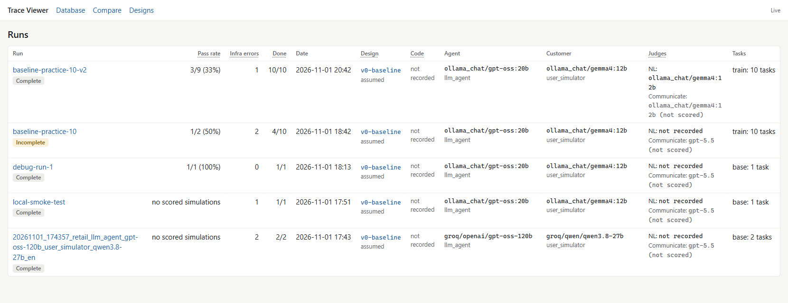

# Agent on τ²-bench: error analysis and a trace viewer

I'm building a customer-support AI agent and measuring it honestly on
[τ²-bench](https://github.com/sierra-research/tau2-bench) (Sierra Research), retail domain.
This repository contains **only my work**: the trace viewer, my error analysis, the run data and
the small changes I had to make to the benchmark. The benchmark itself belongs to Sierra Research
and is not copied here.

**Start here → [`trace_viewer/`](trace_viewer/)**

| Read | What it is |
|---|---|
| [`trace_viewer/MY_WORK.md`](trace_viewer/MY_WORK.md) | Exactly what I did, step by step, and what I found |
| [`trace_viewer/STUDY.md`](trace_viewer/STUDY.md) | The study design: setup, rules, metrics, results so far, limitations |
| [`trace_viewer/README.md`](trace_viewer/README.md) | How to run the trace viewer |
| [`runs/baseline-practice-10-v2/`](runs/baseline-practice-10-v2/) | The raw baseline run (all conversations and raw model calls) |
| [`trace_viewer/annotations/`](trace_viewer/annotations/) | My failure labels for that run, linked to design decisions |
| [`benchmark-changes/`](benchmark-changes/) | The only two changes I made to the benchmark, and why |



## Use it

1. Clone τ²-bench at the commit this work used:
   ```
   git clone https://github.com/sierra-research/tau2-bench
   cd tau2-bench
   git checkout da0835f6c67baef58bdda18f2a3b037dfb3a1754
   uv sync
   ```
2. Copy this repository's `trace_viewer/` folder into the `tau2-bench` folder.
3. To browse my baseline run, copy `runs/baseline-practice-10-v2/` into `tau2-bench/data/simulations/`.
4. Start the viewer from the `tau2-bench` folder (Windows): `.\trace_viewer\start.cmd`
5. To reproduce my runs with local judges, apply `benchmark-changes/local-judges.patch` (see its README).

## Credit

τ²-bench is © Sierra Research, MIT License (copy in `benchmark-changes/TAU2-BENCH-LICENSE`).
The trace viewer was specified, reviewed and verified by me and implemented with AI coding
assistance (Claude Code). Details in `MY_WORK.md`.
