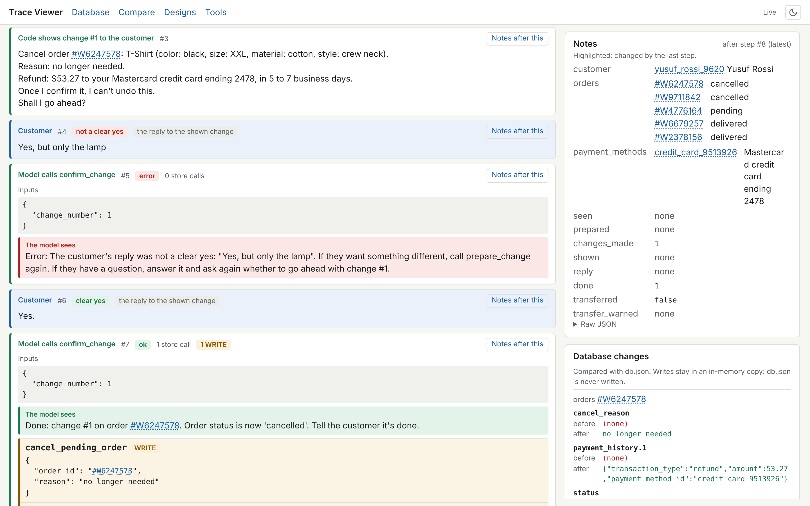

# My work

What I actually did, in order, and what I found. Everything here can be checked against the run
data in [`../runs/baseline-practice-10-v2/`](../runs/baseline-practice-10-v2/) and my labels in
[`annotations/`](annotations/).

**How the work was split.** I chose the problem, set up and debugged the environment, specified
the trace viewer phase by phase, verified each phase against the raw data, and did the error
analysis. The trace viewer's code was written by Claude Code from my specifications. I used Claude
as a reviewer to check the viewer's numbers independently and to challenge my labels; where it
corrected me, that is written down below.

For my own agent ([`../fde_agent/`](../fde_agent/), sections 6–8), the code was written by Claude
in a step-by-step session: for each piece we agreed a spec first, then it wrote the code and
explained it, then the tests. I made the design decisions (the ones that came from me are marked,
including the one where I went against Claude's recommendation), reviewed the code, ran the tests
and every benchmark run on my own machine, and decided when to stop.

## Why

My goal is to become a Forward Deployed Engineer. Before this I spent two weeks reading how agents
are built: workflows vs agents, harnesses, context engineering, tool design, evals and agent
security, plus real FDE case studies. This project is where I apply that: build an agent, measure
it, find out why it fails, and fix it with explicit engineering decisions.

## 1. Choosing the benchmark

τ²-bench, retail domain: a fake online store (500 customers, 1,000 orders, 50 product types), a
written policy, about 15 tools, and AI-simulated customers. A task passes only if the store
database ends up exactly as expected, plus (for some tasks) an LLM judge confirms the agent told
the customer the right thing.

Rules I set for myself:
- Same agent model, same customer model, same judge and same tasks in every run. Only the agent
  design changes, so any improvement comes from design, not a bigger model.
- A fixed practice set of 10 training tasks: `0 1 2 3 4 6 7 8 10 11`.
- The 40 held-out test tasks are used once, at the end.

## 2. Getting it to run (1 Nov 2026)

| Problem | What I found | What I did |
|---|---|---|
| Groq free tier failed instantly | One agent request (policy + tool list + conversation) is ~4,000 tokens; the limit was 8,000 tokens per minute, and later requests grow past it | Switched to local models with Ollama |
| Local setup | Agent `gpt-oss:20b`, customer `gemma4:12b` (a different model family, so the two sides don't "think alike") | Raised Ollama's context length to 32k so prompts aren't silently cut |
| Run crashed on Windows | Folder names come from model names; Ollama names contain `:`; Windows forbids `:` in file names | Pass `--save-to` for every run (bug noted for a possible upstream report) |
| Ollama "connection refused" mid-run | I had restarted Ollama during a run | Don't restart Ollama while running |
| "Incorrect API key" on some tasks after ~10 minutes | A hidden third model: the LLM judge, hard-coded to paid OpenAI models | Pointed the judge at local `gemma4:12b` ([details](../benchmark-changes/README.md)) |
| "Expecting value: line 1 column 1" | The local judge wrapped its JSON in a markdown fence | 3-line parsing fix ([details](../benchmark-changes/README.md)) |

## 3. Baseline run (`baseline-practice-10-v2`, 1–2 Nov 2026)

The benchmark's default agent (`llm_agent`) on the 10 practice tasks, 1 trial each, about 7–36
minutes per conversation on my laptop.

**Result: 3 of 9 scored tasks passed (33%).** Task 8 was an infrastructure error (an Ollama call
timed out after 600 s) and is excluded.

## 4. Building a trace viewer (2 Nov 2026)

Reading raw logs was too slow to do real error analysis, so I specified a local viewer and had it
built in three phases, testing each before starting the next.

1. **Runs and conversations:** every run, every conversation as a timeline, every raw model call
   (what was sent, what came back, tokens, time).
2. **Back to the source:** a database explorer, every ID clickable to its record, and the final
   database (expected vs actual) replayed with the benchmark's own evaluator.
3. **Design and analysis:** the agent's design written as 18 named decisions (D1–D18) with links
   to the source lines; failure labels linked to design decisions; automatic checks; run
   comparison; live updates; a run recorder that saves the command, note, design version and code
   diff with each run.

How I checked it (with Claude as an independent reviewer):
- The benchmark code is unchanged apart from my two documented edits (checked with git).
- The viewer's numbers match an independent recount of the raw data: 3/9 passed, 77 tool calls,
  14 tool errors.
- The database replay agrees with the official database check on all 8 scored tasks.
- The design file's key decisions match the agent's real source code.
- The automatic identity check flags exactly tasks 0 and 1.

## 5. Error analysis

I labelled each task, then compared my labels with an independent review against the data. Some
of my first labels were wrong, and the corrections taught me the most:

- I thought the agent looked up **too many** orders. The data showed the opposite: a customer
  record lists order IDs **without status**, so every order must be opened. In task 3 the agent
  opened only 2 of 5 orders, missed the pending one with the small v-neck t-shirt, and said the
  item didn't exist.
- I marked task 4 as "wrong changes applied". The database check passed: the changes were right.
  Only its message was wrong. Lesson: judge actions by the database, not by what the agent says.
- I said task 11 "allowed" a refund to a different payment method. The agent tried, but the tool
  rejected it, and it then did it correctly: a rule enforced in code worked.
- My own catch that the review had missed: in task 1 the agent chose the payment method itself,
  but the policy says the customer must provide it. The score doesn't notice, because the expected
  answer uses the same card.

### Final labels

| Task | Result | Labels | Design decisions |
|---|---|---|---|
| 0 | pass | skipped-identity-check | D3 |
| 1 | fail | skipped-identity-check, wrong-variant-choice, assumed-customer-detail | D3, D14, D15, D11 |
| 2 | fail | misread-tool-output (said 12 t-shirt options, 10 available), malformed-tool-call | D14, D6, D13, D18 |
| 3 | fail | incomplete-lookup | D15, D17 |
| 4 | fail | misread-tool-output | D14 |
| 6 | stopped | malformed-tool-call, ignored-customer-change | D6, D13, D18, D15 |
| 7 | fail | wrong-variant-choice | D14, D15 |
| 8 | infra | setup-problem | – |
| 10 | pass | – | – |
| 11 | pass | attempted-policy-violation (blocked by the tool) | D16 |

### What's breaking (failures per design decision)

| Decision | Failures |
|---|---|
| D14: reading tool results is left to the model | 4 |
| D15: no record of the customer's conditions or a plan | 4 |
| D6 / D13 / D18: tool calls not validated, duplicates not stopped | 2 |
| D3: identity verification is prompt-only | 1 (+1 passing task) |
| D11: confirmation is prompt-only | 1 |
| D17: escalation is prompt-only | 1 |

Problems the official score does not catch: skipped identity verification (task 0 passed anyway)
and an agent-chosen payment method (task 1).

## 6. Building my own agent: the tool layer (3 Nov 2026)

**Decision: build my own agent from scratch** instead of patching the default one. I start with the
**tools**, because tools are plain code and can be tested without any model. One tool at a time:
spec, then code, then tests against the real store and the real database.

**The principle:** the model turns the customer's words into a structured request; code does
everything that must be exact (finding, filtering, counting, money, rule checks). The model is only
used for judgement: understanding the customer, deciding when to hand over, friendly wording.

Example: a customer says *"I'm looking for a blue t-shirt in large size."* The model sends
`find_variants(product_name="t shirt", options={"color": "blue", "size": "large"})`. Code replies
"T-Shirt has no size 'large'. Values for size: L, M, S, XL, XXL." The model retries with `L`, and
code answers: no blue T-shirt in L exists; the closest available ones are blue in M or S, or red
in L, each with its price.

### The 7 tools

| Tool | What it does | Baseline failure it targets |
|---|---|---|
| `verify_customer` | Email or name + zip. Shows the account: address, payment methods, **every order with its status and items** | Task 3 opened 2 of 5 orders and missed the pending one; tasks 0 and 1 skipped verification |
| `get_order` | One order: items with IDs and prices, payments, tracking, and **"possible actions" for its status, written in code from the rulebook** | Task 6 invented a tool (`modify_delivered_order_items`) |
| `find_variants` | A product's variants, filtered by what the customer wants. **Counts only available ones.** Lists the real option values when the model guesses wrong. Shows the closest available ones when nothing matches | Tasks 2 and 4 said "12 options" (10 are available); task 1 missed that the requested keyboard was out of stock |
| `find_replacement` | "The same item, but with X changed": code keeps every other option, finds the exact item, works out the price difference | Tasks 1 and 7 picked the wrong variant |
| `prepare_change` | Checks a change against every rule and describes it for the customer. **Never writes to the database** | Writes made without checks |
| `confirm_change` | **The only tool that writes.** Runs exactly the prepared change, only after code has shown the summary and the customer clearly said yes | Task 6 called the exchange tool for both items **before asking the customer anything** |
| `transfer_to_human` | Hand over to a human, once, with a summary | Task 3 called it 3 times and leaked its reasoning to the customer |

Shared pieces: ID labels and checks (`ids.py`), the agent's working notes kept by code (`notes.py`),
and a small layer that lets every store call go through the benchmark, so it is recorded
(`store.py`).

### The decisions, and where they came from

- **ID labels (my idea).** The model mixed up item IDs and product IDs, which are both 10-digit
  numbers. Now it only sees `item_8722653925` and `product_4896585277`, and code checks the label
  before every store call. Refined together: order and payment IDs already look different, so only
  items and products get labels, and code also rejects any ID that no tool has shown (invented IDs).
- **Follow the rulebook when it disagrees with the store code.** After an order's items are changed,
  the rulebook says nothing more can be changed; the store code still allows address and payment
  changes. The tasks are written from the rulebook, so we follow it.
- **A clear warning before changes that can't be undone (my addition).** "Once I confirm it, I can't
  undo it. If you want an address or payment change, tell me now." Made true for each kind of
  change: an address or payment change *can* be redone, so it doesn't get that warning.
- **Never offer the item being replaced (my rule).** The store's exchange tool doesn't block
  exchanging an item for the identical item, so our code does. I first said "no item that's already
  in the order"; in 84 orders that would block valid requests (two different jigsaw puzzles in one
  order), so we block only the item being replaced and *mark* another item already in the order.
- **Show the closest options when nothing matches.** Turns "not found" into real alternatives.
- **One `prepare_change` tool with 7 kinds**, with an example call for each kind. Claude
  recommended seven small tools for a 20B model; I chose one tool with clear examples. The code has
  one checker per kind, so if the traces show malformed calls, splitting it is a small change.
- **Code shows the summary to the customer word for word**, so the customer approves exactly what
  will run, and **code judges the "yes"**: it needs a yes-word and none of "but", "only",
  "except", "instead", "wait", "not", "no", "actually" or a question mark. Strict on purpose: a
  wrong "no" costs one more question; a wrong "yes" changes the database.
- **One reminder before transferring with an unfinished change.** After a transfer the conversation
  ends, so an agreed return would be lost. The first transfer call gets a reminder; a second call
  always goes through.

### What going back to the raw data corrected

Two of my earlier explanations were wrong:
- **Task 6:** I thought the customer narrowed the request at confirmation and the agent ignored it.
  In fact the agent called the exchange tool for both items **before showing the customer
  anything**. The fix is structural: no tool can write except `confirm_change`.
- **Task 3:** the transfer was requested by the customer. The real failure came earlier: the agent
  missed the pending order with the small t-shirt and told the customer it didn't exist.

Also found in the store's code: the exchange tool doesn't block exchanging an item for itself;
cancelling refunds every entry in the payment history; changing several items at once records the
last new item's price for all of them (checked: a new $184.48 wall clock was saved at $547.55, the
new air purifier's price; the expected database is built with the same code, so the score isn't
affected); and no two customers share a name and zip code, so the
"ambiguous customer" error can never happen with this data.

### Testing

**121 tests, no model, against the real store and database.** For example:
- Asking for a blue T-shirt in size L finds nothing and offers the 3 closest available ones.
- The requested clicky keyboard is reported as not available, and the customer's own keyboard is
  never offered as a replacement.
- `prepare_change` never writes: every test checks that only read calls were made.
- The real sentence from task 6, "I'll take the lamp, but I'm not doing the water bottle", is not
  accepted as a yes. Confirming twice writes once.

To run them: copy `fde_agent/` into the `tau2-bench` folder, then
`uv run --with pytest python -m pytest fde_agent/tests -v`. (pytest isn't installed in the
benchmark's environment; plain `uv run pytest` can pick up a different Python and fail with
"No module named 'tau2'". That happened to me.)

### Testing the tools in the trace viewer

A new **Tools** page in the trace viewer, where I run the tools by hand: I play the model (pick
a tool, fill in its inputs) and the customer (show a prepared change, type a reply). The code
was written by Claude Code from my specification, in three phases, and I checked each phase
before the next.

*The "Cancel + confirm" preset: the summary is shown to the customer word for word, "Yes, but
only the lamp" is refused, "Yes." confirms with exactly one write, and the database changes
panel shows the cancellation.*

**How it works.** The viewer's own environment has no tau2, so the tools run in a worker under
the benchmark's environment. A session is a list of steps (tool runs and customer actions), and
every action replays all of them on a fresh in-memory database, so a session can never drift
and "reset" just means starting with no steps. Tool descriptions and input forms are read from
the tool modules, never copied, so the page shows exactly what the model will see.

**What it has:** each tool with its form; what the model sees (green or red) and every store
call with its result, writes marked; "show change" and "customer says", with a live check of
whether the yes rule accepts what I type; the agent's notes after any step; every database
field the session changed; undo and reset; four ready-made sessions (presets, in
`tool_presets.yaml`); and a button that runs `fde_agent`'s 121 tests and lists each result.

How it was checked (by Claude, independently of Claude Code, on a fresh copy of my folder):
- The checkpoint list from my specification gives exactly the expected results: Yusuf's 5
  orders; "large" refused with the real sizes; blue in L not found with 3 closest options;
  confirming before the summary was shown refused; "Yes, but only the lamp" refused and quoted;
  "Yes." confirms with exactly one write; confirming again is "already done". The only database
  change: order #W6247578, pending -> cancelled.
- In a real browser: all four presets load, a tool run by hand through its form works (desk
  lamps, low brightness: the 3 right lamps, cheapest first), the live yes-check switches as
  you type, "Run fde_agent tests" shows 121 passed, and there are no errors in the page.
- The worker checks the database file's fingerprint before and after every session: unchanged.
  The viewer's tests also fail if anything in `fde_agent/` changes while they run.
- `fde_agent/`, the benchmark's code and its data were not touched.
- All 422 viewer tests pass (including the new ones) and all 121 tool tests pass.

Also added without being asked: a light/dark mode switch. Harmless; I kept it.

**My main folder.** I now work in one folder: a full copy of τ²-bench plus my own work. Its
`.gitignore` is a whitelist (ignore everything, then allow only my folders), so Sierra's code,
the data and my `.env` with an API key can never be pushed by accident.
One side effect: `record_run` saves the agent's code with each run using `git diff`, and the
benchmark's code is now ignored by git, so that diff is empty for the old baseline agent. My own
agent lives in `fde_agent/`, which git tracks, so its design file will point there.

## 7. The agent loop (4–6 Nov 2026)

With the tools done, the rest of the agent was built the same way: one piece at a time, spec
first, then code, then tests without a model.

| Piece | What it does |
|---|---|
| Driver (`driver.py`) | Runs the conversation: asks the model what to do, runs our tools, passes their store calls through the benchmark, keeps a transcript and a full log |
| Model client (`model_client.py`) | Calls the model and checks every reply **before** anything runs: unknown or empty tool names, bad inputs, text and a tool call in one reply, several calls, broken JSON. Rejected replies go back to the model as an error; small slips (junk on a tool name, a number sent as text) are fixed and logged |
| Instructions (`instructions.md`) | 477 words of my own, plus a table that points every rule sentence in the store's policy to the code or the instruction line that covers it |
| Loop rules | Code sends the change summary word for word, code sends the transfer sentence, replies that show internal IDs are not sent |
| Benchmark adapter (`agent.py`, `run.py`) | Plugs the driver into τ²-bench and writes `fde_agent_log.json` next to each conversation, so the trace viewer shows every internal step: who wrote each message (model, code or benchmark), every check that fired, and every raw model call |

**A decision against measuring each fix alone.** I had planned switches to turn each fix off and
rerun, to see what each one was worth. I skipped them: this agent is a practice project built
around one model, and each run takes hours on my laptop. Results below are for the whole design.
My next agent will have switches built in from day one.

**Before any benchmark run:** 16 of 18 live test scenarios passed with the real model (6 scenarios,
3 runs each). The same test can pass one day and fail the next even at temperature 0: local Ollama
isn't fully repeatable, so I report pass rates over repeated runs, not single results.

## 8. Runs, failures and fixes (6–9 Nov 2026)

Each round: run, read every failed conversation in the viewer, decide whose fault it was (my agent
or the simulated customer), fix the agent's faults in code, test the fix offline by replaying the
exact moment from the run, then run again. All runs are in [`../runs/`](../runs/).

### Round 1: the first runs

**Smoke runs on task 0.** The second one failed in an instructive way: my summary asked two
questions ("Is there any other item you want to exchange?" and "Shall I go ahead?"). The customer
answered both: *"I don't have any other items… go ahead"*. My strict yes rule saw "don't" and
refused it, the agent asked again, and the customer left before anything was saved.
- **Fix (my design):** a second check. When the code's rule says no, a model with **no
  conversation** reads only the summary and the reply and answers YES or NO. When the rule says
  yes, the model is never asked. Live test: 27 of 27 replies judged correctly.
- Summaries ask one question only.

**Practice run (`v1-practice-10`): 3 of 9**, the same as the baseline but on different tasks. In
3 of the failures my agent had exactly the right change ready, and the customer said *"Yes, go
ahead"* and ended the chat **in the same message**. The baseline's customer, the same model, did
that 0 times in 9; mine did it 4 times. The cause was on my side: my summary read like a finished
change (*"You get $16.63 back. You'll get an email…"*). The baseline asked *"Reply yes and I'll
start the exchange."* Two of the failures were plain agent mistakes (preparing a new change after
the customer said yes, which threw the yes away).
- **Fixes:** the summary starts with *"Nothing has changed yet"* and ends with *"I'll make the change as
  soon as you say yes"*; no new change can be prepared while a yes is waiting; code reminds the
  model when a change is still waiting.

### Round 2: practice rerun and the first unseen tasks

| Run | Result |
|---|---|
| `v1-practice-10-b` (same tasks, after the fixes) | **6 of 9** (customer "yes + leave" dropped from 4 to 1) |
| `v1-unseen-10` (10 train tasks my fixes had never seen) | **6 of 10** |

The practice score flatters me, because the fixes came from those tasks. The unseen score is the
honest one. Both runs showed new problems, and two of them are worse than a failed task:
- The customer said *"Yes."*, the model skipped the confirm step and told the customer *"Your return
  has been requested"*. Nothing was returned.
- Before the customer gave any details, the model looked up *"John Doe, zip 90210"*.
- *"Yeah, looks right. Go ahead and use my gift card"* passed the yes rule; the change was made on
  PayPal, and the model then said it was "covered by your gift card".

### Round 3: eight more fixes, then a fix to the fixes

| Fix | What it does |
|---|---|
| A waiting yes comes first | While the customer's yes waits, only `confirm_change` may run: no other tool, no message |
| Payment in a yes | A yes that names another payment method is not a plain yes |
| Code says "done" | After a change is made, code tells the customer what the store actually did |
| No invented customers | A name, zip or email the customer never said can't be used for a lookup |
| Same product elsewhere | The model is told which other orders have the same product ("change **all** my t-shirts") |
| Cheap re-verify | Verifying the same customer again reloads nothing |
| **Clean history (my idea)** | Once the model recovers, it stops seeing its own failed steps. Errors that state a fact about the store are kept as a short note. Every tool error is marked as a fact or a usage error (62 errors, 18 facts) |
| **No identical calls (my idea)** | A call with exactly the same inputs as an earlier successful one isn't run; the model is pointed to that result |

**The smoke test caught a bug in my own fix.** The customer said *"Just go ahead with the desk
lamp"* to a summary with a lamp and a water bottle. The yes rule read a yes. The model was right:
it asked "just the lamp?" and prepared the lamp-only change. But the new "a waiting yes comes first"
rule blocked both and forced the confirm. Both items were exchanged.
- **Lesson:** a word rule can't understand "just the lamp". The more power I gave it, the more its
  misreads cost.
- **Fix:** the rule now accepts only plain yeses ("Yes, go ahead"). Anything that says "just" or
  names an item goes to the second-check model. And when the rule and the model disagree, that
  model decides. The same smoke test then passed.

In total the agent has 27 named design decisions (F1–F27) in
[`designs/v1-fde-agent.yaml`](designs/v1-fde-agent.yaml), each linked to its source lines and to the
baseline decision it replaces. 263 tests run without a model (each fix replays the real moment
from a run, and I broke each fix on purpose to check its test catches it), plus 17 live tests with
the real model.

## 9. Results

Same agent model (`gpt-oss:20b`), customer model (`gemma4:12b`), judge, seed and limits in every
run; 1 trial per task.

| Tasks | Baseline | My agent |
|---|---|---|
| Practice 10 (`0 1 2 3 4 6 7 8 10 11`) | 3 of 9 | round 1: 3 of 9 → round 2: **6 of 9** (in-sample) |
| Unseen 10 (`13 14 15 16 19 20 21 22 23 24`) | not run | round 2: **6 of 10** |
| Fresh 10 (`25 28 29 30 31 34 35 37 41 43`) | 1 of 5 scored | round 3: 3 of 6 scored |
| Fresh 10, tasks scored in **both** runs (25, 28, 30, 37) | 1 of 4 | **2 of 4** |

**Read these carefully.** The samples are small, every task ran once, and local models aren't
repeatable, so a single task can flip by luck. The fresh run is the cleanest test of the final
design, and it is also the smallest.

### The real bottleneck: the simulated customer

The customer in τ²-bench is also an AI model, here running on my laptop. In the fresh runs it
froze and timed out (600 s) again and again, sometimes on its very first message, before any agent
had said a word:
- Baseline: 23 of its 24 failed attempts were the customer; 5 of the 10 tasks couldn't be scored.
- My agent: 21 of 22 failed attempts were the customer; 4 of the 10 tasks couldn't be scored.
- The two fresh runs took 10.5 and 12.4 hours.

So which tasks get scored at all came down to the customer model, and most of the time went to
waiting for it.

## 10. Why I'm stopping here

Every round taught me something real, but each round now costs a day of laptop time, and the
customer model decides more of the result than my agent does. Swapping the customer model would
mean re-running every baseline to keep the comparison fair. That is time better spent on new
problems. This was a practice project to learn the process, and it did that.

**What I'm taking to the next project:**
1. **Code-enforced rules beat prompt rules, but a rule is only as good as its reading of
   language.** My yes rule refused real yeses and accepted narrowed ones. Give a rule power only in
   proportion to how well it reads; hand ambiguous cases to an independent check.
2. **Wording is part of the system.** A summary that sounded finished made customers leave before
   the change was made (4 times vs 0).
3. **Read the traces, not the score.** Several failures I first blamed on the customer were mine,
   and the other way round.
4. **Fixes found on some tasks flatter those tasks.** Always measure again on tasks you haven't
   looked at.
5. **Choose the evaluation setup before building.** Slow local models decided what I could
   measure. Next time: API models, and switches to turn each fix off from day one.

**Left open:**
- When the customer asks for an option that doesn't exist ("Google Home"), the agent picks the
  closest one ("Google Assistant") without saying so.
- "The most expensive variant, but in size 9" is still beyond the model.
- If a customer says "Yes, and also change the address" to an item change on a pending order, the
  items are confirmed first, and the address can't change afterwards.
- The trace viewer shows the round-3 check events as plain "other" steps.
- The 40 held-out test tasks were never used: I stopped before a final test run.
