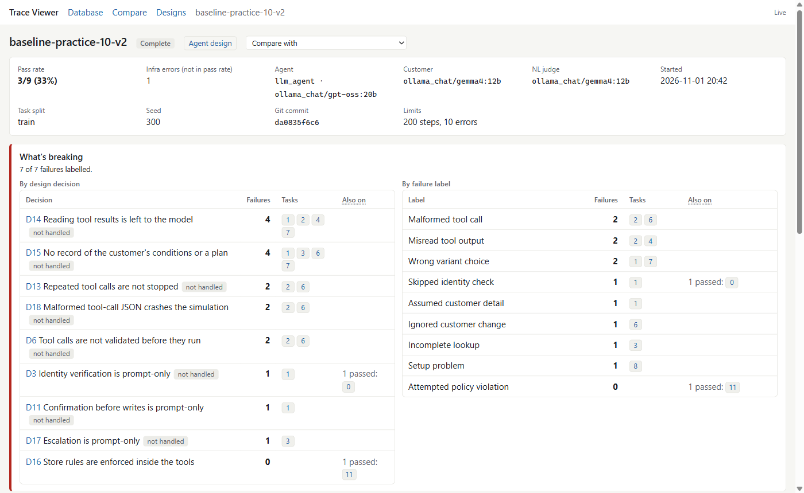
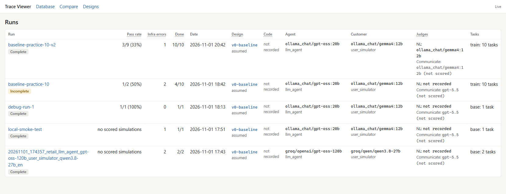
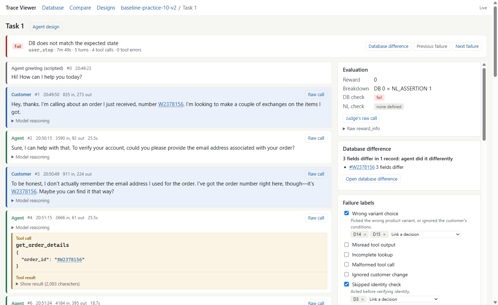

# Trace Viewer

A local web app for finding out why a τ-bench run failed. It takes you from a pass rate
to the exact conversation, raw model call, database change and agent design decision
behind each failure.



It runs only on your computer, at `127.0.0.1`, and needs no API keys. It never changes
your run results or `db.json`.

This repository is [τ-bench](https://github.com/sierra-research/tau2-bench) with this
folder added, plus [two small edits](#run-the-benchmark-with-local-models) in `src/tau2/`
so that runs work on local models. Everything else is the original benchmark.

## Open the viewer

You need [uv](https://docs.astral.sh/uv/getting-started/installation/) and Git. In
PowerShell:

```powershell
git clone https://github.com/HungryFingerss/agent-on-tau2-bench.git
cd agent-on-tau2-bench
.\trace_viewer\start.cmd
```

If you already have the repository, you only need the last line. Run it from the repo
root.

The first start installs the viewer's dependencies. Your browser then opens
<http://127.0.0.1:8765>. Press Ctrl+C in the terminal to stop.

| Option | Use |
|---|---|
| `--port 9000` | Use another port. |
| `--no-browser` | Don't open a browser tab. |

The clone downloads about 450 MB and takes about 1.4 GB on disk, because it includes all
of τ-bench's data and history.

The viewer has its own `pyproject.toml`, `uv.lock` and `.venv`, so it does not change the
benchmark's environment or lock file. Only the database difference needs the benchmark
installed. Run this once from the repo root to enable it:

```powershell
uv sync --frozen
```

On macOS or Linux, this command should start the viewer, but only Windows has been
tested:

```bash
uv run --frozen --project trace_viewer python trace_viewer/main.py
```

## See your runs

The viewer lists every folder in `data/simulations/`. Git does not track run results, so
a fresh clone opens with "No runs found" until you add one:

- **Copy a run in:** put its folder in `data/simulations/`.
- **Start a new run:** see [Run the benchmark with local models](#run-the-benchmark-with-local-models).

You don't need to restart the viewer. New runs and results appear by themselves,
including runs still in progress. Task pages show a reload button instead of changing
while you read them.



## Find out why a task failed

1. **Open a run.** The top of the page shows *What's breaking*: which design decisions
   and failure labels account for the most failures.
2. **Pick a failed task.** Tick *Failures only* to hide the rest.
3. **Read the verdict.** The line at the top of the task says what failed, for example
   "DB does not match the expected state".
4. **Follow the conversation.** Open *Raw call* on any step to see what the model
   received and returned. Click any ID to see its database record.
5. **Open the database difference** to see what the agent changed compared with the
   expected result.
6. **Label the failure** and link it to a design decision. *Next failure* takes you to
   the next one.



## Run the benchmark with local models

This repository runs on [Ollama](https://ollama.com), so you need no API keys. Stock
τ-bench judges runs with OpenAI models, so two edits are already in place:

| File | Change |
|---|---|
| `src/tau2/config.py` | The NL judge and the communication scorer use `ollama_chat/gemma4:12b`. |
| `src/tau2/evaluator/evaluator_nl_assertions.py` | The NL judge accepts text around its JSON reply. |

To use different judge models, change them in `src/tau2/config.py`.

Get the models and start a run. One task takes about 7 minutes, and the two models need
about 16 GB of free memory.

```powershell
ollama pull gpt-oss:20b
ollama pull gemma4:12b
.\trace_viewer\record_run.cmd --design v0-baseline --note "first run" --name my-first-run -- --domain retail --task-split-name train --task-ids 10 --agent-llm ollama_chat/gpt-oss:20b --user-llm ollama_chat/gemma4:12b
```

Keep the viewer open in another terminal to watch the run arrive.

## What you can do

- **Runs:** every folder in `data/simulations/`, with models, judges, pass rate and
  infra errors.
- **Run:** one row per task and trial. Tick *Failures only* to focus on what broke.
- **Task:** the verdict and its cause, the conversation, the task as it ran, the
  evaluation, and every attempt. Use *Previous failure* and *Next failure* to walk
  through a run.
- **Raw call:** on any agent or customer step, shows the system prompt, message
  history, tool definitions, response, reasoning, token counts and time.
- **Database:** browse and search users, orders, products and variants from
  `db.json`. Products show every variant, as in "T-Shirt: 12 variants, 10 available".
- **ID links:** click any user, order, product, item or payment method ID to open its
  record beside the conversation. Ctrl+click opens it in a new tab.
- **Database difference:** on each task, how the agent's final database differs from
  the expected one, field by field.
- **Agent design:** each run's design decisions, exact system prompt, tools and
  parameters, with links to the source behind each decision.
- **Failure labels:** label a task, link the label to a design decision, and see which
  decision is breaking most at the top of the run page.
- **Automatic checks:** five rules computed on every task, each showing its definition.
- **Compare:** two runs side by side, with results, checks, labels and design changes.
- **Tools:** run your agent's tools by hand, playing both the model and the customer.
- **Light and dark mode:** the button at the top right. Until you pick one, the viewer
  follows your system's setting. The choice is kept in this browser only.

## Testing your agent's tools

The **Tools** page runs the tools in `fde_agent/tools/` by hand, against the real retail
store and an in-memory copy of `db.json`. You play both the model and the customer, in
one session that behaves like one conversation.

- **As the model:** pick a tool. The description and the form come from the module's
  `DESCRIPTION` and `PARAMETERS`, so you see exactly what the model will see. Strings
  are text fields, enums are dropdowns, and objects and arrays are JSON boxes.
  Examples written as `Example: {...}` in a description fill the form in one click.
- **Each run** shows the text the model would see, green if it worked and red if not,
  and every store call with its arguments, result, error flag and whether it is a WRITE.
- **As the agent loop and the customer:** *Show change #N* calls `notes.mark_shown(N)`
  and shows the prepared summary as the agent's message. *Customer says* calls
  `notes.customer_said(text)`, and shows as you type whether
  `confirm_change.is_clear_yes` would accept it. After a successful transfer, the agent's
  message is `TRANSFER_MESSAGE`.
- **Notes** are shown after the latest step, or after any step with *Notes after this*.
  Fields that step changed are highlighted.
- **Database changes** list every field the session changed, compared with `db.json`.
  ID links open records as they are in `db.json`, not as the session changed them.
- **Undo last step** replays the session without its last step. **Reset session** starts
  again from a fresh database and empty notes.
- **Presets** load a whole ready-made session in one click, replacing the current one:
  *Verify Yusuf Rossi (zip 19122)*, *Blue T-shirt in L*, *Keyboard -> clicky* and
  *Cancel + confirm*.
- **Run fde_agent tests** runs `fde_agent/tests` and lists every test as passed,
  failed, error or skipped. Failures come first, with the assertion, the traceback and
  anything the test printed. The full pytest output is in its own tab.

### Presets

Presets live in `trace_viewer/tool_presets.yaml`. Edit it freely: the page reads it
again each time it opens, and a mistake shows on the page with the preset and step it
is in. A step is one of these:

```yaml
- tool: get_order               # the model calls a tool
  inputs: {order_id: "#W2378156"}
- show_change: 1                # code shows the prepared change to the customer
- customer_says: "Yes."         # a customer message
```

Quote values that YAML would read as something else: a zip code such as `"19122"`
would become a number, and a bare `Yes` would become `true`.

### Running fde_agent's tests

The button runs the command that works on Windows, from the repo root:

```powershell
uv run --with pytest python -m pytest fde_agent/tests -q
```

It adds three options: a JUnit XML report, which gives each test's result; the
captured output of failing tests; and no pytest cache. Bytecode goes to the viewer's
cache, so a run adds nothing to `fde_agent/`. A run takes about 10 seconds.

The page keeps the session as a list of steps and sends all of them with every action.
`tools_worker.py` starts under the benchmark's `.venv`, builds a fresh environment with
`get_environment()` and fresh `Notes`, and replays every step with `store.run_now`.
Nothing carries over between actions, so what you see always follows from the steps.
`db.json` is never written, and the worker checks its hash before and after to prove it.

Each action takes about 4 seconds, nearly all of it spent importing tau2. The first one
after a fresh install takes about 15 seconds, while Python compiles the benchmark's
packages into `trace_viewer/.cache/pycache`. Nothing is written into `fde_agent/` or
`src/`. A session survives reloading the page, but not closing the tab.

## Starting a recorded run

Use this instead of `uv run tau2 run`, so the run can be understood later:

```powershell
.\trace_viewer\record_run.cmd --design v0-baseline --note "baseline" --name my-run -- --domain retail --task-split-name train --num-tasks 10 --agent-llm ollama_chat/gpt-oss:20b --user-llm ollama_chat/gemma4:12b
```

| Option | Meaning |
|---|---|
| `--design` | Required. A file in `trace_viewer/designs/`, and it must be for the agent you run. |
| `--note` | Required. Why this run exists, such as "added identity gate". |
| `--name` | The run's folder name. Defaults to the date and design. |
| `--resume` | Continue an existing run. It cannot change design partway. |

Everything after `--` goes to `tau2 run`. The script adds `--verbose-logs`,
`--llm-log-mode all` and `--save-to`, and sets `UV_FROZEN=1` so the root `uv.lock` is
not rewritten.

In Windows PowerShell 5.1, escape the double quotes in JSON arguments. PowerShell
removes them otherwise, and `tau2` then refuses the value:

```powershell
--agent-llm-args '{\"temperature\": 0.2}'
```

It saves three files next to `results.json`, and these are the only files it writes in
`data/simulations`:

| File | Contents |
|---|---|
| `run_meta.json` | The exact command, dates, note, design, commit, judge models and exit code |
| `agent_code.diff` | Uncommitted changes to the design's `code_paths`, including new files |
| `run_meta.heartbeat` | Kept fresh while the run is alive |

The diff matters because the commit saved in `results.json` does not show uncommitted
changes. Runs started with plain `tau2 run` still appear, marked as not recorded.

## Agent designs

A design is a file in `trace_viewer/designs/`. Copy `v0-baseline.yaml` for a new agent
and change what differs. Each decision has an ID, a status of `implemented` or
`not_handled`, what code enforces, what is left to the model, and its source locations.

`not_handled` entries record what the agent does not do. They use the same D numbers,
so a failure can be linked to a gap in the design.

Cited line numbers go stale when code changes, so a design stores a hash of each file
it cites, and the viewer warns when one no longer matches. After updating a design,
print fresh hashes with:

```powershell
uv run --project trace_viewer python -m viewer.designs <design_version>
```

The prompt shown for a run comes from a saved model call. The `policy` field in
`results.json` leaves out a language line that the benchmark adds inside `<policy>`,
so it is not the full text the model saw.

## Failure labels

Labels live in `trace_viewer/labels.yaml`. Edit the file and the viewer picks it up
without a restart. Which decisions a label links to by default is set by `label_links`
in each design, and you can change the links on any task.

Your labels are saved in `trace_viewer/annotations/<run_name>.json`, never in
`data/simulations`. Git tracks these files, so labels are kept with the repository even
though the runs are not. They reappear when a run with the same name is present.

On the run page, **What's breaking** ranks design decisions by how many failures link
to them. A decision counts once per task. Labels on tasks that passed are shown apart.

## Automatic checks

| Check | Rule | Suggests |
|---|---|---|
| Identity verified first | `find_user_id_by_email` or `find_user_id_by_name_zip` succeeded before any account tool: `get_user_details`, `get_order_details` or a database-changing tool. Product lookups and `calculate` do not count. | `skipped-identity-check` |
| Duplicate tool calls | Same tool and arguments as the previous call, with no customer message between. | `malformed-tool-call` |
| Invalid tool calls | The name is not in the run's tool list, or the arguments fail the schema or include an unknown one. | `malformed-tool-call` |
| Tool errors | Tool results marked as errors, with their messages. An error can be a correct refusal. | none |
| Write without a customer yes | The customer's previous message has no confirmation word. This is a word match, so it always means "needs review". | `unconfirmed-write` |

Infrastructure errors also suggest `setup-problem`. Suggestions are never applied for
you: a click confirms each one. Checks can fire on passing tasks too.

## Run status

| Status | Meaning |
|---|---|
| Running | The run script's heartbeat is fresh. |
| Stopped unexpectedly | The run script stopped updating its heartbeat without finishing. |
| Finished | The run script finished, and `tau2` exited cleanly. |
| Finished with an error | The run script finished, and `tau2` reported an error. |
| Complete | Not recorded, and every task has a result. |
| May be running | Not recorded, and something happened in the last 45 minutes. This is a guess. |
| Incomplete | Not recorded, some tasks have no result, and nothing happened recently. |

A long silence does not mean a run has died: one model call can take 40 minutes across
its retries. That is why recorded runs use a heartbeat.

## Reading the results

| Label | Meaning |
|---|---|
| Pass | Reward is 1. |
| Fail | Scored, with reward below 1. |
| Stopped early | The run ended before scoring (for example `too_many_errors`), so reward is 0 and no check ran. Counts as a failure. |
| Infra error | The task never finished, for example a model timeout. Left out of the pass rate, as in τ-bench's own metrics. |
| Pending | The task has no simulation yet. |
| DB: not evaluated | The check never ran. This is not the same as failing it. |
| NL: none defined | The task has no NL assertions. The benchmark scores this as a vacuous 1.0. |
| Turns | Customer messages. |
| Tool errors | Tool results with `error: true`. |
| Expected actions | One reference path, not a requirement. The DB check compares end states, so a different path can still pass. |

An **attempt** is one `sim_<uuid>` folder in `artifacts/`. The runner retries failed
tasks and `results.json` keeps only the final one, so other attempts exist only there.

| Attempt status | Meaning |
|---|---|
| Final | Recorded in `results.json`. |
| Failed | Crashed and was retried. Its error is shown. |
| Discarded | Thrown away and re-run. |
| No status | No `sim_status.json`: the run was interrupted, or is still running. |

## Reading the database difference

| Label | Meaning |
|---|---|
| Agent missed this | A change was expected, and the agent left the initial value. |
| Agent added this | This was expected to stay as it was, and the agent changed it. |
| Agent did it differently | Both changed it, to different values. |
| Same on both sides | The agent and the expected path ended on the same value. |

This comes from replay, not from the viewer's own logic. `replay_worker.py` runs under
the benchmark's `.venv` and calls the benchmark's `EnvironmentEvaluator`, keeping the
two environments it builds. It uses the same code as `tau2 evaluate-trajectories` to
reload the data the run recorded, and refuses if that data has changed.

- The first open of a simulation takes about 5 seconds. After that the result comes
  from `trace_viewer/.cache/`, which you can delete at any time.
- **Evidence** shows both database hashes and whether the replay reproduces the verdict
  in `results.json`. If it does not, the panel says so.
- Comparison is as exact as the benchmark's hash, so `0.05` and `0.04999999999999716`
  count as different. List order counts too.
- A simulation that stopped early, such as on `too_many_errors`, still gets a
  difference, even though the benchmark never scored it.
- Simulations with no conversation cannot be replayed. Failed attempts are not replayed.

## IDs in the conversation

An ID shown with a red wavy underline fits the shape of an ID but is not in `db.json`.
That usually means the agent or customer made it up or mistyped it, so it is worth a
look. An order written without `#` still links, with a note, because the tools reject
that form.

IDs are not linked in the system prompt or tool definitions, whose documentation
examples would be wrongly marked, or in `task.log`. Raw JSON stays exactly as saved.

Database records are the **initial state** from `db.json`, before any simulation.

Links and replay work on English retail runs only. Other domains and languages use
other databases, where links would point at the wrong records.

## Getting complete data

Run with both flags:

```powershell
uv run tau2 run ... --verbose-logs --llm-log-mode all
```

`--verbose-logs` alone keeps only the last call of each type, because the default
log mode is `latest`. Without `--verbose-logs` no raw calls or logs are saved.

Some data is not saved by the benchmark in any mode:

- A model call that failed is never written, so a timed-out request has no raw call.
  Its error is in the attempt's status and `task.log`.
- Reasoning and finish reason exist only in `results.json`, so failed attempts have
  none.
- The NL judge's model is not in `results.json`. It is read from a saved judge call,
  and shows as *not recorded* when none exists.

## Running it during a benchmark

This is safe, but only because of how the reader is built. On Windows, the
benchmark's save fails if anything has `results.json` open at that moment, and a
failed save loses a finished simulation. Even `stat()` can cause this. So the viewer
watches the folder listing, waits for the file to be quiet for a second, and never
opens it during a save. New results can therefore take a moment to appear.

Keep these rules if you change `viewer/store.py`, then rerun the stress test. Auto-update
follows them too: the page polls `/api/changes`, which only lists folders and never
opens `results.json`. The replay worker never opens it either: the viewer hands it the
data it already holds.

## Tests

```powershell
uv run --project trace_viewer pytest trace_viewer/tests
```

Tests check the viewer's numbers against `baseline-practice-10-v2`, and replay it
through the benchmark's evaluator. That folder is gitignored, so those tests skip if it
is missing. Replay tests also skip if the benchmark's `.venv` is missing. Tools tests
run your tools against the real database, and skip if `fde_agent/` or that `.venv` is
missing. They also fail if anything in `fde_agent/` changed while they ran. Tests of the
*Run fde_agent tests* button use a small throwaway suite, so they do not depend on
whether `fde_agent`'s own tests pass today.

`tests/stress_live_save.py` is a manual check that takes about four minutes. It runs
the benchmark's save pattern against the real reader and reports any lost save.

## Layout

```
start.cmd, main.py   entry point, bound to 127.0.0.1:8765
record_run.cmd, .py  starts a recorded benchmark run
replay_worker.py     replays a simulation under the benchmark's .venv
tools_worker.py      runs fde_agent's tools under the benchmark's .venv
                     (these two workers are the only files importing tau2)
labels.yaml          the failure labels
tool_presets.yaml    ready-made sessions for the Tools page
designs/             one file per agent design
annotations/         your saved labels, one file per run
docs/                screenshots for this README
viewer/
  store.py           find runs, read results.json safely
  verdicts.py        result, DB and NL states, pass rate, one-line cause
  timeline.py        messages to timeline steps
  artifacts.py       attempts, raw calls, step matching, task.log
  database.py        db.json browsing and search
  replay.py          starts the replay worker, caches results
  tools.py           starts the tools worker, loads the presets
  fde_tests.py       runs fde_agent's tests and reads each result
  dbdiff.py          field-by-field comparison
  checks.py          the automatic checks and their definitions
  designs.py         load, verify and compare design files
  annotations.py     labels, saved annotations, the run summary
  runmeta.py         what a recorded run saved, and whether it is alive
  changes.py         change detection for auto-update
  compare.py         comparing two runs
  pages.py           JSON behind each screen
  insight.py         adds designs, checks and labels to those screens
  api.py             routes
static/              frontend, with no build step
tests/
```
